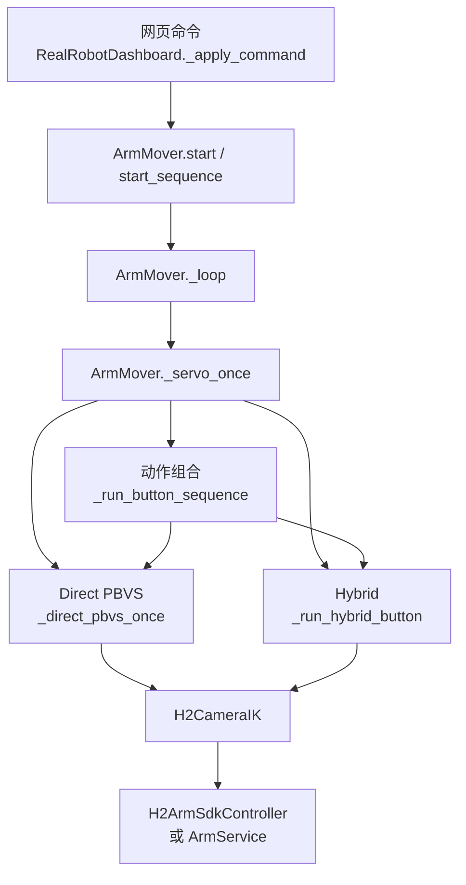

# 空调面板控制链路

网页按钮进到 `ArmMover`，视觉给出按键在躯干系下的坐标，逆解把右臂指尖解到该点，再由 `arm_sdk` 或运控服务把关节指令发出去。组合任务按同一条链路重复每一颗键。

当前运行代码在 `ibvs_pad_touch/web/`、`ibvs_pad_touch/perception/`、`ibvs_pad_touch/servo/`。同名的 `ibvs_pad_touch/ibvs_pad_touch/` 是旧副本，网页不加载它。

## 总链路

## 1. 网页入口

| 步骤 | 文件 | 符号 |
| --- | --- | --- |
| 启动网页 | `scripts/run_web.py` | `main` |
| 页面与命令 | `ibvs_pad_touch/web/dashboard.py` | `RealRobotDashboard`、`_apply_command` |
| 选键 | 同上 | `LiveIbvsAnnotator.set_target`，由 `ibvs.set_target` 调用 |
| 单次启动 | `ibvs_pad_touch/web/arm_motion.py` | `ArmMover.start` |
| 组合启动 | 同上 | `ArmMover.start_sequence` |
| 后台循环 | 同上 | `ArmMover._loop` → `_servo_once` |

`start(sequence=False)` 按当前模式把 `control_stage` 设成 `DIRECT_PBVS` 或 `PBVS_COARSE`。`start(sequence=True)` 只置 `_sequence_run`，真正的按键循环在下一次 `_servo_once` 里进入 `_run_button_sequence`。

## 2. 看见按键和指尖

胸口相机负责按键三维点，右腕相机负责最后进近时的图像误差。

| 步骤 | 文件 | 符号 |
| --- | --- | --- |
| 每帧标注 | `ibvs_pad_touch/web/live_ibvs.py` | `LiveIbvsAnnotator.annotate` |
| 分割面板、姿态点 | `ibvs_pad_touch/perception/yolo_touch.py` | `YoloTouchDetector` |
| 按键布局整理 | 同上 | `normalize_button_layout`、`apply_pose_buttons` |
| Revo2 用指尖、丢掉夹爪尖 | 同上 | `pose_finger_tip`、`without_gripper` |
| 相机坐标到躯干坐标 | `ibvs_pad_touch/web/live_ibvs.py` | `camera_xyz_to_torso` |
| 给控制线程的状态 | 同上 | `LiveIbvsAnnotator.telemetry` |
| 右腕指尖锁定 | 同上 | `latch_wrist_finger_tip` |
| 打开或关闭右腕监视 | 同上 | `set_wrist_pbvs_watch`、`wrist_pbvs_view` |

权重由 `YoloTouchDetector` 读取：

- 分割：`outputs/runs/yolo12_seg_20261014_1045/weights/best.pt`
- 姿态：`outputs/runs/yolo26s_pose_20261103_1130/weights/best.pt`

姿态点顺序是 `gripper_tip`、`button_1`、`button_2`、`button_3`、`FingerTip`。Revo2 点按用 `FingerTip`。

## 3. Direct PBVS

一次把指尖解到胸口看到的按键坐标，中间不做右腕图像进近。

| 步骤 | 文件 | 符号 |
| --- | --- | --- |
| 进入 | `arm_motion.py` | `ArmMover._direct_pbvs_once` |
| 求解循环 | 同上 | `ArmMover._direct_pbvs_run` |
| 运控服务时的笛卡尔 | 同上 | `ArmMover._direct_pbvs_via_service` |
| 是否到位 | 同上 | `direct_pbvs_arrived` |
| 结束并记坐标 | 同上 | `ArmMover._finish_direct_pbvs`、`_record_action_pose` |
| 6 自由度位姿 | `Hand_Eye_Calib/handeye_calib/h2_ee_ik.py` | `H2CameraIK.apply_loaded_tool_pose_target` |
| 指尖位置 | 同上 | `H2CameraIK.tip_xyz` |
| 小步平移 | 同上 | `H2CameraIK.apply_tip_delta` |

`_direct_pbvs_run` 最多 3 轮、每轮 3 段。三轴合成误差在 2 mm 以内，并且指尖没有探过按键超过 1 mm，`direct_pbvs_arrived` 才算到位。

## 4. Hybrid

先用胸口 PBVS 把指尖粗对到按键前，再交右腕相机做图像进近。

| 步骤 | 文件 | 符号 |
| --- | --- | --- |
| 整颗键 | `arm_motion.py` | `ArmMover._run_hybrid_button` → `_run_hybrid_button_run` |
| 胸口粗定位一步 | 同上 | `ArmMover._pbvs_once` |
| 只降高度 | 同上 | `pbvs_descent_step` |
| 已对准后再前进 | 同上 | `pbvs_forward_step` |
| 横向修正 | 同上 | `pbvs_lateral_step` |
| 探过按键就回退 | 同上 | `coarse_x_retract`、`pbvs_retract_step` |
| 右腕进近一步 | 同上 | `ArmMover._wrist_approach_once` |
| 图像误差到相机速度 | `ibvs_pad_touch/servo/interaction.py` | `eye_in_hand_ibvs_step` |
| 近距没有深度时对齐再前进 | 同上 | `eye_in_hand_close_align_step` |
| 交互矩阵 | 同上 | `point_interaction_matrix`、`camera_velocity` |

粗定位停在按键前约 3 mm。腕部进近时，像素差大于 8 px，`eye_in_hand_ibvs_step` 把相机 Z 速度置 0，只在图像里对齐；对齐后再沿相机 Z 靠近面板。接触由 `wrist_contact` 结束，阶段变成 `contact`。

## 4.1 LLM Hybrid

和 Hybrid 共用胸口 PBVS 粗定位。末端进近改由远程 LLM 看右腕 JPEG，返回躯干系小步 `delta_xyz`（每轴不超过 15 mm）。网页按钮：`mode_llm_hybrid`、`sequence_llm_hybrid`。单次 Start 与组合启动都会先检查 `H2_LLM_URL` 的连通性，连接超时 60 秒，不含后续推理时间。上传、Qwen、T40 和本体的启动命令在 `Qwen启动与部署.md`。

| 步骤 | 文件 | 符号 |
| --- | --- | --- |
| 选模式 | `arm_motion.py` | `ArmMover.set_servo_mode("llm_hybrid")` / `set_sequence_mode("llm_hybrid")` |
| 启动前探测 | `ibvs_pad_touch/web/llm_fine.py` | `check_llm_connection` |
| 末端一步 | `arm_motion.py` | `ArmMover._llm_approach_once` |
| 请求位移 | `llm_fine.py` | `request_tip_delta` |

## 5. 动作组合

| 步骤 | 文件 | 符号 |
| --- | --- | --- |
| 按序列执行 | `arm_motion.py` | `ArmMover._run_button_sequence` |
| 重新看这颗键 | 同上 | `ArmMover._recognize_sequence_button` |
| Direct 的一颗 | 同上 | `ArmMover._run_direct_sequence_button` |
| Hybrid 的一颗 | 同上 | `ArmMover._run_hybrid_button` |
| 键与键之间移开 | 同上 | `ArmMover._retreat_clear_of_panel` |
| 全部结束放下 | 同上 | `ArmMover._finish_sequence_and_release` |
| 屏幕是否变化 | `ibvs_pad_touch/web/screen_read.py` | `read_panel`、`blocks_differ` |
| 屏幕进度 | `arm_motion.py` | `ArmMover._read_progress_screen` |

每一颗先识别，再走 Direct 或 Hybrid。未到位、IK 拒绝、识别失败都先下移再右移，然后重试。同一颗最多 3 次重试，之后进入下一颗。打开「读取屏幕判断进度」后，按之前和每次按完都会截屏；屏幕变了才算按到。

单次 Start 打开屏幕进度时走 `ArmMover._run_single_press_with_screen`，里面仍调用上面的 Direct 或 Hybrid。

## 6. 逆解和发出去

| 步骤 | 文件 | 符号 |
| --- | --- | --- |
| 加载 URDF 和运动学 | `h2_ee_ik.py` | `ensure_robot_kinematics`、`resolve_urdf` |
| 正运动学 | 同上 | `H2CameraIK.fk_xyz_rpy` |
| 解到指定位姿 | 同上 | `H2CameraIK.solve_loaded_tool_pose` |
| 本进程直接发关节 | `Hand_Eye_Calib/handeye_calib/h2_arm_sdk.py` | `H2ArmSdkController` |
| 读关节、插值到目标角 | 同上 | `measured_arm_rad`、`ramp_arm` |
| 运控服务笛卡尔 | `ibvs_pad_touch/web/arm_service.py` | `ArmService.move_cartesian` |
| 播放逆解出的关节轨迹 | `arm_motion.py` | `ArmMover._play_cartesian_samples` |
| 躯干系小位移 | 同上 | `ArmMover._apply_torso_delta` |

默认后端是 `arm_sdk`，类是 `H2ArmSdkController`。网页切到服务后端后，笛卡尔走 `ArmService.move_cartesian`，对应运控的 `/h2_arm/singlearmcartesian`。

动作结束时 `ArmMover._record_action_pose` 把实测指尖和目标按键写进网页的「动作结束坐标」。释放和急停在 `release_for_operator`、`emergency_stop` 里也会记一行。

## 7. 手

| 步骤 | 文件 | 符号 |
| --- | --- | --- |
| 右手按压预备 | `ibvs_pad_touch/web/revo2_hand.py` | `Revo2Hand.hold_press_now` |
| 动作前的食指预备 | 同上 | `Revo2Hand.prepare_outward_then_thumb` |
| 左手食指 | 同上 | `LeftRevo2.point_index` |
| 串口速度闭环 | `ibvs_pad_touch/web/revo2_serial.py` | 按 `revo2_test.yaml` 的 `test_pose` 下发 |

Dex1 不走这条串口。它的指尖偏移仍是 `H2CameraIK.tip_xyz` 的默认 `(0.205, 0, 0)`。

## 8. 屏幕记录

到了温湿度页或事件记录页时，另外记照片和 OCR 报告。这不参与手臂伺服。

| 步骤 | 文件 | 符号 |
| --- | --- | --- |
| 判定页面并生成报告 | `ibvs_pad_touch/web/panel_report.py` | `build_report`、`ocr_items` |
| 写入数据库 | `ibvs_pad_touch/web/panel_records.py` | `PanelRecords.store_screen` |
| 8082 客户页 | `ibvs_pad_touch/web/records_site.py` | `build_records_app` |
